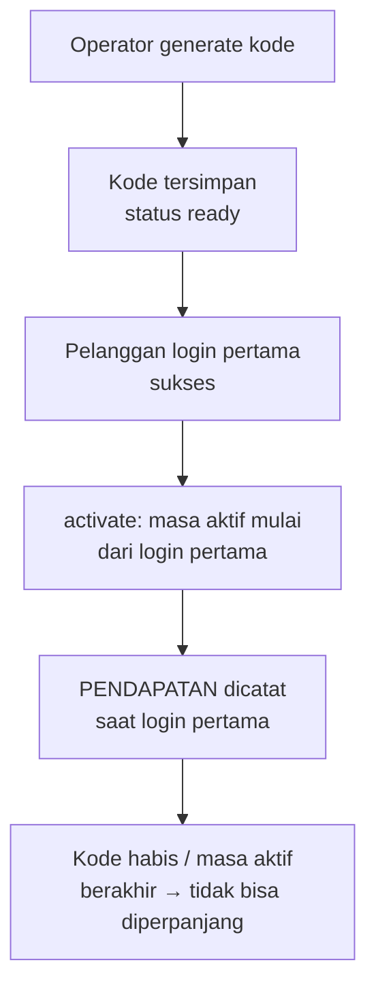
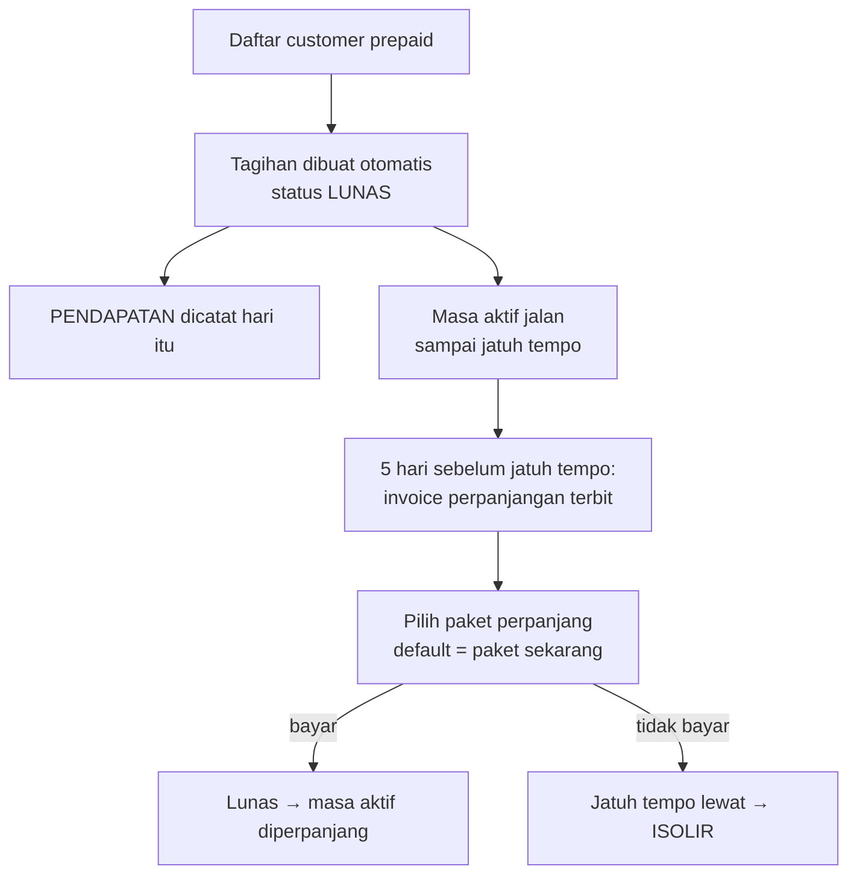
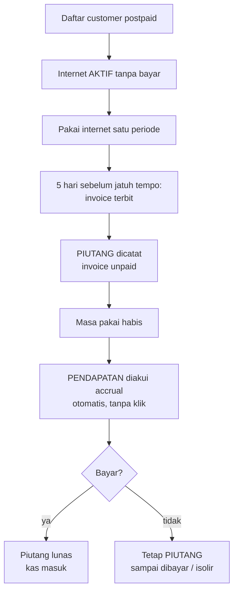

# Model Billing Jawara-ISP

> Dokumen desain — patokan tertulis sebelum implementasi.
> Status: **SPESIFIKASI TERKUNCI (2026-11-06)** — hasil penyelarasan bersama operator.

## 1. Ringkasan

Sistem billing membagi pengguna menjadi dua entitas besar, lalu memakai tiga jalur
pengakuan pendapatan yang berbeda:

1. **Voucher** — kode internet hasil generate mesin (sekali pakai, tak diperpanjang).
2. **Customer** — pelanggan terdaftar lewat halaman Pelanggan (hotspot/PPPoE), dengan
   satu dari dua tipe pembayaran: **prepaid** (bayar dulu) atau **postpaid** (pakai dulu).

Aturan inti yang mengikat seluruh model: **1 customer = 1 tipe layanan = 1 akun**.

## 2. Kamus Istilah

| Istilah | Definisi |
|---|---|
| **Voucher** | Akun hasil *generate* mesin, baik `username = password` maupun `username` + `password` terpisah. Sekali pakai, tidak bisa diperpanjang, tidak terikat customer. |
| **Customer** | Pelanggan yang terdaftar lewat Pelanggan (hotspot/PPPoE). Memiliki `billing_type`. |
| **Prepaid** | Bayar di muka. Sistem menganggap tagihan **lunas** saat pendaftaran. |
| **Postpaid** | Pakai dulu, bayar setelah masa pakai. Tagihan tercatat sebagai **piutang** sampai dibayar. |
| **Masa aktif** | Umur layanan satu akun, dihitung dari login-pertama (voucher) atau dari tanggal siklus (customer). |
| **Piutang (AR)** | Tagihan yang sudah terbit tetapi belum dibayar (khusus postpaid). |
| **Jatuh tempo** | Tanggal `billing_day` tiap bulan; batas pembayaran tagihan. |

Catatan migrasi: istilah **"member"** dihapus dari model. Akun lama `user_type='member'`
(terikat `customer_id`) dipetakan ulang menjadi **customer**.

## 3. Pengakuan Pendapatan

| Entitas | Titik pengakuan | Basis | Piutang? |
|---|---|---|---|
| **Voucher** | Login **pertama** yang sukses (konsumsi) | konsumsi | Tidak |
| **Customer prepaid** | Saat **pendaftaran/perpanjangan** — sistem menganggap **lunas**, pendapatan dicatat hari itu | cash | Tidak |
| **Customer postpaid** | Saat **masa pakai habis** (jasa sudah dinikmati), terlepas dari sudah dibayar atau belum | **accrual** | Ya — selama belum dibayar |

Konsekuensi pengakuan:

- **Prepaid** = uang dianggap masuk saat daftar → langsung masuk **pendapatan**.
- **Postpaid** = tagihan terbit → masuk **piutang**; saat masa pakai habis → diakui
  **pendapatan** (accrual) meski uang belum masuk; begitu dibayar → piutang lunas.
- **Voucher** = pendapatan diakui saat kode benar-benar dipakai (login pertama), bukan saat
  dibagikan/dicetak.

## 4. Data Model

### 4.1 Perubahan pada tabel yang ada

**`customers`** — tambah kolom:

| Kolom | Tipe | Keterangan |
|---|---|---|
| `billing_type` | `ENUM('prepaid','postpaid')` | Default `prepaid`. Menentukan jalur tagihan & pengakuan. |
| `billing_day` | `TINYINT UNSIGNED NULL` (1–31) | Hari jatuh tempo bulanan. `NULL`/default = tanggal registrasi. Nilai asli tidak pernah diubah. |
| `next_billing_day` | `TINYINT UNSIGNED NULL` (1–31) | Perubahan tanggal tagihan yang tertunda; berlaku mulai siklus berikutnya. |

**`radius_vouchers`** — rekonsiliasi nilai `user_type`:

| Nilai | Arti baru |
|---|---|
| `voucher` | Kode hasil generate (sekali pakai, `customer_id` NULL). |
| `customer` | Akun milik pelanggan (`customer_id` terisi) — **menggantikan** nilai lama `member`. |

Migrasi satu baris: `UPDATE radius_vouchers SET user_type='customer' WHERE user_type='member'`.

**`invoices`** — tambah kolom:

| Kolom | Tipe | Keterangan |
|---|---|---|
| `revenue_recognized_at` | `DATETIME NULL` | Titik waktu pendapatan diakui. Prepaid = saat dibuat (lunas); postpaid = saat masa pakai habis; voucher = tanpa baris invoice. |

### 4.2 Pencatatan akuntansi (ledger)

Reuse `finance_events` sebagai buku besar. Tiga *kind* kejadian (perlu diselaraskan dengan
skema `finance_events` yang ada — lihat §8):

| Kind | Kapan | Contoh |
|---|---|---|
| `receivable` | Tagihan postpaid terbit | piutang bertambah |
| `revenue` | Pengakuan pendapatan | prepaid daftar / postpaid masa habis / voucher login pertama |
| `cash` | Pembayaran diterima | `payments` + invoice → paid |

## 5. Alur

### 5.1 Voucher

### 5.2 Customer Prepaid

### 5.3 Customer Postpaid

## 6. Siklus Tagihan

- Invoice terbit **otomatis** `N` hari sebelum jatuh tempo. `N` = setting global, default **5**.
- `billing_day` = hari jatuh tempo tiap bulan; default = **tanggal registrasi**, bisa diubah manual (mis. 25).
- **Bulan pendek**: tanggal jatuh tempo = `min(billing_day, hari_terakhir_bulan)`.
  `billing_day` yang tersimpan **tidak pernah diubah** (billing_day=30 tetap 30; di Februari
  jatuh tempo = 28/29).
- Konsekuensi telat bayar: **prepaid** → isolir (layanan putus); **postpaid** → isolir
  (opsional: toleransi/denda sebelum isolir).

## 7. Pindah Paket & Perubahan Tanggal Tagihan

**Pindah paket:**
- **Prepaid**: boleh pindah paket saat **perpanjang**; opsi default = paket yang sedang dipakai.
- **Postpaid**: **terkunci** selama tagihan sebelumnya belum lunas.

**Perubahan tanggal tagihan (`billing_day`):**
- Default: disimpan di `next_billing_day`, berlaku **mulai siklus berikutnya**; periode berjalan
  **tidak dihitung ulang**.
- Kalau harus berlaku langsung: buat **periode transisi** terpisah + **prorata ke depan saja**.
  **Tidak pernah** prorata mundur.

## 8. Catatan Implementasi

1. Sebelum mengubah ledger, **inspeksi dulu skema `finance_events`** dan `payments` yang ada
   (kolom `entity_type`, `entity_id`, dsb.) supaya `kind` baru tidak bentrok.
2. Pemicu pengakuan voucher = metode `activate()` di layanan penegak (deteksi login pertama) —
   tinggal tambah pencatatan keuangan di sana.
3. Scheduler tagihan = satu proses periodik (interval) yang mencari customer dengan
   `jatuh_tempo - N hari <= hari ini` lalu membuat invoice; jangan per-customer cron.
4. `revenue_recognized_at` untuk postpaid diisi oleh scheduler saat deteksi "masa pakai habis",
   bukan oleh aksi manual operator.
5. Pembuatan tagihan prepaid-lunas & postpaid-unpaid harus dalam satu transaksi DB.

## 9. Open Items

- Skema pasti `finance_events` & `payments` (dibaca saat mulai implementasi ledger).
- Apakah postpaid butuh **denda** keterlambatan; model sekarang hanya isolir.
- Nomor/template invoice untuk ketiga jalur (voucher/prepaid/postpaid) — apakah seragam atau berbeda.